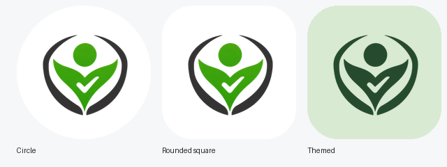
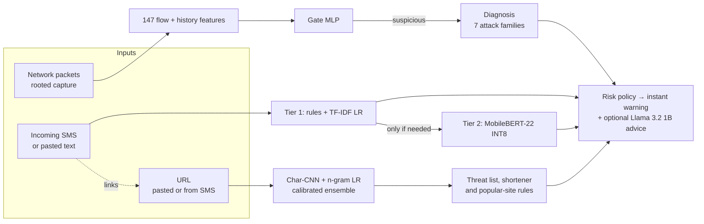

<p align="center">
  
</p>

<h1 align="center">Rakshak</h1>

<p align="center">
  <b>On-device AI protection against network intrusions, SMS scams and phishing links for Android</b><br>
  Everything runs on the phone. No cloud. No INTERNET permission.
</p>

<p align="center">
  <a href="https://github.com/vishwajeet-singh-bhati/rakshak/actions/workflows/checks.yml"></a>
  
  
  
</p>

| | |
|---|---|
| 📄 **Final project report** | [19-page PDF and editable LaTeX](docs/final_submission_report/README.md) |
| 🎬 **2-minute demo video** | <!-- DEMO_VIDEO_LINK --> _Link added after upload_ |
| 📱 **Download the app** | [Latest release APK](https://github.com/vishwajeet-singh-bhati/rakshak/releases/latest) |
| 🧪 **Reproduction setup and limits** | [REPRODUCE.md](REPRODUCE.md) |
| **Manual network tests: setup, then commands one by one** | [Complete guide](docs/NETWORK_TEST_PROCEDURE.md) |

---

## The problem

Scam SMS ("share your OTP with our agent", fake KYC updates, parcel re-delivery fees), phishing links that imitate banks and login pages, and attacks on phones joined to shared Wi-Fi networks are everyday threats. Most protection tools send your messages or browsing data to a server, cover only one threat, and show alerts that ordinary users can't act on.

## What Rakshak does

Rakshak runs **three independent AI detectors on the phone** and explains every warning in plain language.

| Detector | How it works | Key result |
|---|---|---|
| 💬 **SMS scam detection** | Text normalisation + scam-evidence rules + TF-IDF logistic regression; deeper check with an **INT8 MobileBERT (22 layers)** only when needed | **97.12 %** accuracy, **89.8 %** scam recall on an 869-message test set |
| 🔗 **Phishing link detection** | Character-CNN with 27 URL features + character n-gram model, calibrated into PHISHING / UNCERTAIN / LIKELY SAFE, plus local rules | **172/218 (78.90%)** known-positive model detection; **3.940 ms** median detector time. No verified benign cohort. |
| 🌐 **Network intrusion detection** | Rooted packet capture → 147 connection and history features → small gate model → attack-family diagnosis (CNN + attention + LSTM) | Flagged a controlled 129-port scan and labelled it *Port Scan*; **1.583 ms** current-graph timing in the paired component test (1.182 ms was an unshipped candidate) |

- Links inside incoming SMS are extracted and checked **automatically**.
- Each warning appears immediately as **"What happened / What you can do"**.
- An optional local **Llama 3.2 1B** (INT4) model rephrases the advice. It never decides the risk and never sees the raw SMS, the OTP or the full URL.
- Each detector has its own on/off switch. SMS and link checks work on a compatible **ARM64 Android phone**; network monitoring needs a **rooted** test phone.

<p align="center"></p>

## Architecture



More detail: [model architecture](docs/rakshak/architecture/README.md) · [network pipeline](docs/CURRENT_PIPELINE.md) · [SMS component](components/sms/README.md) · [URL component](components/phishing_url/README.md)

## Install and use

### Option A: download the APK (easiest)

1. On an Android 8.0+ phone, download **`Rakshak.apk`** from [Releases](https://github.com/vishwajeet-singh-bhati/rakshak/releases/latest). Successful CI runs on this branch upload it as the `rakshak-apk` artifact under [Actions](https://github.com/vishwajeet-singh-bhati/rakshak/actions).
2. Open the file and allow **Install unknown apps** when Android asks.
3. Open **Rakshak** → **Detection controls** → turn on **Automatically check incoming SMS and links** → allow the SMS and notification permissions.
4. To check something manually, use **Check a message or link** and paste the text or URL. You can also *Share* text to Rakshak from any app.

That's all you need for SMS and link protection.

### Option B: build from source

Requirements: Java 21, Android SDK 34 (platform-tools on `PATH`), Python 3.12+.

```bash
git clone https://github.com/vishwajeet-singh-bhati/rakshak.git
cd rakshak
python reproduce.py build-android --sdk "$ANDROID_HOME"     # or: android/gradlew -p android :app:assembleDebug
adb install -r android/app/build/outputs/apk/debug/app-debug.apk
```

### Optional extras

- **Network monitoring** (rooted test phone only): `python reproduce.py install-phone --serial <SERIAL> --start`. See [Android setup](docs/ANDROID_SETUP.md).
- **Local Llama explanations** (1.06 GiB, separate license): `python reproduce.py download-llama --accept-license`, then install with `--llama external_models/llama`. The app works fully without it.
- **Local phishing threat list:** the public build ships an empty list because feed licences restrict redistribution. To fill it: `python tools/setup_runtime_feeds.py --assets android/app/src/main/assets/url --download-phishtank`.

## Results

| Evaluation | Result |
|---|---|
| SMS – MobileBERT INT8, 869-message held-out test | Accuracy **97.12 %**, macro-F1 0.909, smishing precision 78.6 % / recall 89.8 % |
| SMS – INT8 vs FP32 | 87.5 MiB → **35.5 MiB** (−59 %) for −0.12 pp accuracy |
| URL - recorded phone benchmark | Learned ensemble detected **172/218 (78.90%)** independently supported positives. **No confirmed benign cohort**: overall accuracy, precision and false-alarm rate are not established. |
| URL – 218 confirmed phishing URLs on the Pixel 6a | Model alone: 172 flagged, 30 uncertain; with local threat list: 218 / 218 |
| Network – CIC-IDS2017 (TSANet reconstruction → + connection context) | 97.03 % → **99.98 %** accuracy (development benchmark) |
| Network – held-out phone sessions (cleartext web attacks from our own lab, same setup as the training data) | 62 / 64 attack segments flagged (0 / 64 before phone training); 10 / 120 normal segments falsely flagged |
| Network – live lab tests on the phone | Port scan (129 ports) flagged, mostly labelled *Port Scan*. SSH/FTP brute force **not distinguished** from normal logins (7 / 8 normal logins also flagged). Low-rate DoS, 3-source DDoS and bot-beacon emulations **missed** |

**Hardware (Pixel 6a, CPU via ExecuTorch XNNPACK):** current detector graph 1.583 ms in a paired component timing; 1.182 ms was an unshipped candidate. URL median 3.940 ms. Earlier monitoring-only PSS was 51.9 MiB in four samples; the optional 1B worker had sampled peak PSS 1.338 GiB. These different scopes are not a universal footprint or event-to-alert latency.

**Optimisations:** post-training INT8 quantization, two-tier cascades (heavy models run only when needed), LSTM graph hoisting (−25.3 % latency, no decision changes), facts-first notifications, and an LLM prompt redesign (21 s → 3.9 s, 5.4× faster). Full details are in [section 7 of the report](docs/final_submission_report/README.md).

**Known limitations** (we report these openly): the network model flags normal SSH/FTP logins as often as brute-force attempts; web-attack detection works only on plain HTTP and was tested on the same lab setup it was trained on; DoS, DDoS and bot emulations were missed in live tests ([attack test audit](docs/ATTACK_TEST_AUDIT.md)); SMS evaluation is mainly English; and a warning is a risk signal, not proof of compromise. See section 9 of the report.

## Privacy

- The APK has **no INTERNET permission**: there is no cloud inference or telemetry, and checked URLs are never opened.
- Rakshak reads only new incoming SMS (with your permission) or text you share with it. It never reads your inbox.
- History keeps no SMS bodies, senders or OTPs, and saved links keep only the host name.
- This repository contains no datasets, private messages, packet captures or credentials.

## Repository layout

```
android/                 Android app (Kotlin), shared feature extractor, test/lab modules
components/sms/          SMS training, PTQ/QAT export, checkpoint, provenance
components/phishing_url/ URL data pipeline, CNN + n-gram training, export, tests
components/integration/  SMS + link combination and shared explanations
experiments/             Network model research: TSANet, context, phone alignment
models/                  Network reference models, Llama download manifest
results/                 Saved evidence behind every reported number (aggregates only)
docs/                    Final report, setup guides, architecture, demo script
validation/  tests/      Phone validation tools and dataset-free unit tests
tools/  reproducibility/ Report builder, feed setup, hashes and manifests
```

Quick checks (no dataset or phone needed):

```bash
pip install -r requirements.txt
python -m pytest tests -q
python -m unittest validation.test_url_benchmark_metrics
```

## Documentation

| Topic | Link |
|---|---|
| Final report (methodology, results, hardware, optimisation) | [19-page PDF and editable LaTeX](docs/final_submission_report/README.md) |
| Full 91-page technical record (LaTeX source included) | [docs/project_report/](docs/project_report/README.md) |
| Clone-to-phone reproduction, training and lab tests | [REPRODUCE.md](REPRODUCE.md) |
| Android setup (root, Llama, feeds) | [docs/ANDROID_SETUP.md](docs/ANDROID_SETUP.md) |
| Datasets and how to obtain them | [docs/DATASETS.md](docs/DATASETS.md) |
| Inference performance measurements | [docs/INFERENCE_PERFORMANCE.md](docs/INFERENCE_PERFORMANCE.md) |
| What each phone attack test really proves | [docs/ATTACK_TEST_AUDIT.md](docs/ATTACK_TEST_AUDIT.md) |
| Evidence index | [results/README.md](results/README.md) |
| Change history | [CHANGELOG.md](CHANGELOG.md) |

## Team

| | |
|---|---|
| **Team members** | Vishwajeet Singh Bhati · Sumit Kumar · Lakshya Patidar |
| **Institute** | Indian Institute of Information Technology Design and Manufacturing (IIITDM) Kurnool |
| **Faculty mentor** | Dr. Rohit Kumar Das |

## Acknowledgements and licences

This project builds on the TSANet paper (Malode et al., ISED 2025), the CIC-IDS2017, UCI SMS Spam and LSDST-2022 datasets, PhishTank, Tranco and Common Crawl, Google's MobileBERT, Meta's Llama 3.2, and PyTorch ExecuTorch. Datasets and Llama weights are not redistributed. Third-party licences and attribution are listed in [NOTICE.md](NOTICE.md).

## Current evidence and retained PR drafts

The current final report is the 19-page document linked above, with the requested cover, index and team/mentor details. The alternate PDF/HTML added earlier in this PR are retained as [historical PR drafts](docs/report/README.md); their unqualified upstream URL AUC and optimized-candidate timings must not replace the current report. The latest controlled campaign completed 7/13 cases; incomplete protocol startup is inconclusive. Dataset, authored fixtures and live-phone results are separate evidence. The installation/release links above require an actually published compatible build; merging this PR does not itself prove a release exists.
