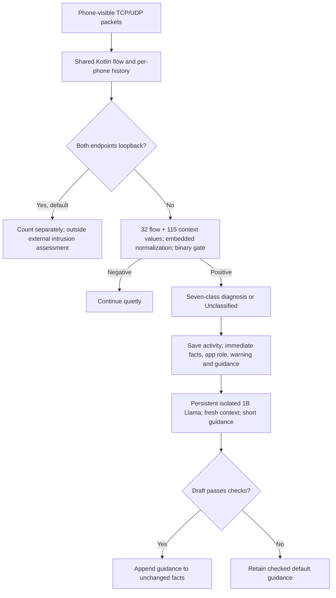

> Current application is Rakshak code46. This document retains the network-core methodology; use the root component index and Rakshak guide for SMS/URL setup, current controls and the empty public-feed policy.

# Current pipeline: code 40

The root capture process observes packets on the phone, not the entire LAN. Extraction uses bounded packet prefixes, TCP/UDP transport statistics,5/30/300-second strictly prior connection histories and limited cleartext protocol indicators. IPs/ports group evidence but are not literal model identity inputs. HTTPS/SSH application contents are not decrypted.

Inputs are float 32`[1,32]`flow and`[1,115]`context. The model wrapper applies log 1 p to nonnegative flow fields and 18 current-flow auxiliary values, then the training-fitted mean/scale; std floor 0.05. Context aggregate logs are not logged twice. The gate is an MLP 147→96→48→1,18,913 parameters. Diagnosis uses the CNN/attention/LSTM/context architecture in `experiments/phone_alignment_v2/models.py`,173,721 parameters. Seven logits correspond to Benign,Bot,BruteForce,DDoS,DoS,PortScan,WebAttack; Unclassified is policy, not a trained eighth class.

Gate sigmoid≥0.5408333333333333 triggers diagnosis. A non-Benign diagnosis maximum≥0.8 establishes only an estimated family. Otherwise the flag stays Unclassified; diagnosis does not veto the binary flag. Llama never makes the intrusion decision.

Loopback is observed separately by default; malicious loopback is consequently also outside that default model scope. Experimental local alerts can be enabled under Device. LAN/private-subnet traffic still enters the detector. No app/port exemption is used. Seven-day activity/history/feedback remain local; user feedback is unverified, not automatic retraining truth.

Ownership is best-effort connected-socket association, with an unambiguous listening-port fallback. A receiver is not identified as the attacker. TIME_WAIT/inode 0 is not an app owner; legitimate UID 0 live sockets remain eligible. Missing ownership is explained; app/service names are never guessed.

Llama 3.2-1 B SpinQuantINT 4 EO 8 uses ExecuTorch Android 1.5.1 in`:llama`. Verified weights stay warm about 120 idle seconds; every request resets context. A 48 forwarded-callback ceiling stops excessive text, with truncation/default fallback; callbacks are not an exact native-token count. Revision/dismissal/scope checks reject stale results.

Example: eight ordinary HTTP requests in the code 40 control produced no flags and no Llama requests. In contrast, a normal SSH control was falsely gate-positive and became Unclassified, producing a factual note plus optional advice. That remains a detector error even if the prose is clear. [Current limitations](../STATUS.md), [model identity](../models/current/MODEL_CARD.md), [full numeric dry runs](project_report/Android_NIDS_Project_Report.tex).
