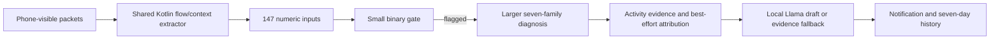

# Current pipeline and experiment map

The current input is 32 flow statistics plus 115 context/protocol fields. Context includes source/destination role aggregates over 5/30/300 seconds, bounded wire indicators and history age. It uses only traffic visible to the watched phone. Literal IP/port identities, class labels and predictions are not numeric inputs. TCP/UDP segmentation, reordering and prefix handling are implemented once in Kotlin; labels are assigned outside that implementation.

The raw-input exports embed training normalization. The installed gate is an 18,913-parameter MLP; diagnosis is a 173,721-parameter CNN/LSTM-attention model. Current augmented-v1 gate cutoff is 0.5408333333333333; type cutoff 0.8. The historical aligned-v2 comparison used 0.7858333333333334/0.6. Gate-negative traffic skips diagnosis. A positive gate remains an alert if diagnosis is Benign, uncertain or unavailable, using Unclassified; diagnosis never vetoes it.

Captured headers/payload prefixes supply limited numeric indicators, not full request understanding. HTTPS is not decrypted. Authentication failures/SQL-like/script-like text can occur in normal activity; they are not independently conclusive attack labels. Target logs and model scores have separate roles.

Attribution uses observed sockets/UIDs where available; closed ports and stale/shared sockets may remain unknown. Llama explains recorded evidence rather than performing the initial detection. Draft validation can reject generation and display deterministic evidence guidance. Current summaries must not be reported as accepted Llama prose unless that flag is true.

| Stage | Inputs and data | Purpose |
|---|---|---|
| Paper reconstruction | 32 CSV flow features,70/30 row split | Transparent reconstruction with stated assumptions |
| Historical context extension | 32+78 features, matched original rows/epochs | Measure added connection context on that benchmark |
| Phone-aligned baseline | 32+115 features from raw captures, grouped 70/15/15 split | Match actual phone extraction/visibility and train gate+diagnosis |
| Current phone-data extension | Original train split plus independently verified real phone requests | Address coverage gaps and matched normal controls; fresh session evaluation |

These stages do not share identical feature definitions/splits/evaluation cohorts. Do not describe every change as an isolated format-only experiment or compare their headline accuracies as interchangeable phone performance.

[Paper assumptions and results](PAPER_AND_CONTEXT.md) stop at the historical context work. [The dataset datasheet](../experiments/phone_capture_v1/DATASHEET.md) covers current collection/labeling limitations. [The model card](../models/current/MODEL_CARD.md) identifies the inference weights actually shipped.

## Current release clarification

Current source is code40 with the augmented-v1 detector, not the historical code36 weights. Read [current pipeline](CURRENT_PIPELINE.md), [status](../STATUS.md), [completed training](../results/phone_capture_training_v1/RESULTS.md) and [protocol testing](PROTOCOL_TESTING.md). All six training jobs completed; readiness remains false. The old v2 reference is kept only for comparison. New cases must be kept separate from already examined development cohorts.
