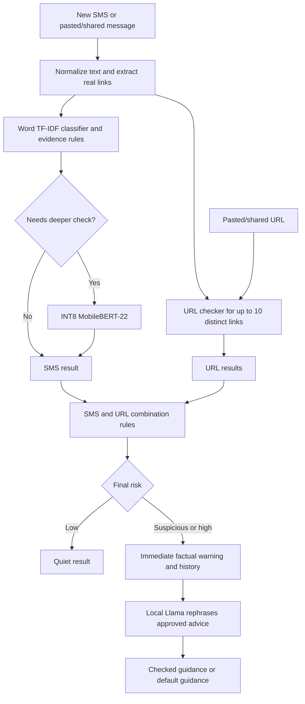

# Rakshak SMS, phishing URL and combined architecture

Verified against the code43 / `0.17.0-rakshak` Android implementation and bundled artifacts on 24 November 2026. This describes the deployed design, including rules that can change a model's suggested class. No weights or app behavior changed during this inspection.

Code44 update: links are checked before SMS classification and can immediately emit a preliminary phishing warning. SMS preliminary and final updates retain those link results. Layer dimensions and weights below remain unchanged.

Code45 update: a message containing only extracted links bypasses SMS semantic escalation; the independent URL verdict still controls link warnings. Narrow standalone celebration phrases also take a guarded low-risk fast path. See the [user case review](../../../results/sms_alert_review_20261124/README.md), including an unresolved reported URL miss.

Code46 update: explicit URL spans are protected during email masking so @ userinfo and query emails do not destroy URL extraction. Ordinary standalone emails retain their original treatment.

## 1. What the three components are

| Component | Actual input | Learned models | Final result |
| --- | --- | --- | --- |
| SMS | Message body; optional sender is used by evidence rules | Word TF-IDF logistic regression, followed selectively by INT8 MobileBERT-22 | Message label, risk, evidence and suggested actions |
| Phishing URL | A URL string, including host, path and query | Character CNN with structural features, character TF-IDF logistic regression, learned score combiner | PHISHING, LIKELY_SAFE or UNCERTAIN, with source/status |
| SMS + URL | The SMS result and separate results for links extracted from that message | Reuses the above; no third joint neural model | A combined risk and actions |

These are different inputs from network intrusion detection. The network branch uses 147 measured connection/history features. It does not pass packets into the SMS or URL models. SMS/URL checks work independently of network capture.



Each detector has an independent switch. Automatic incoming SMS also requires its own switch and Android permission. Incoming multipart SMS is assembled before analysis. Manual paste/share is the route for text from other apps; Rakshak does not read their conversations or the SMS inbox.

## 2. URL detector: input to decision

### 2.1 Normalize the address

The input is the URL text, not the website's HTML, a screenshot, DNS response or network packet. The checker does not open the page, resolve DNS or follow redirects.

The normalizer accepts up to 8,192 codepoints, validates the address, handles IDNA international hostnames and public suffixes, lowercases the scheme/host, removes default ports and fragments, and canonicalizes permitted escapes. Schemes accepted by the implementation are HTTP, HTTPS and FTP. Missing scheme is inferred as HTTP.

The model string is:

```text
host[:nondefault_port]/path[?query]
```

For example, `https://Example.COM:443/login?x=1#section` becomes the model string `example.com/login?x=1`. Scheme and credentials are excluded from that string; a separate feature records whether credentials were present. HTTPS alone therefore does not establish safety.

Ordinary manual checks use the full-URL route, including when the scheme was omitted. The separate explicit `domain` input mode does not run the full-URL classifier.

### 2.2 Branch A: character CNN plus 27 numeric features

**Character input:** `int64[1,256]`.

- Vocabulary: 97 IDs, comprising 94 printable non-space ASCII characters plus PAD, UNK and TRUNC.
- Short inputs are right-padded. Long inputs retain the first 191 characters, one TRUNC token and the last 64 characters.
- PAD positions are masked during pooling.

**Feature input:** `float32[1,27]`, in this exact order:

```text
url_length, host_length, path_length, query_length,
registered_domain_length, num_host_labels, num_subdomain_labels,
num_dots, num_digits, num_special_chars, host_hyphens,
longest_host_label, num_underscores, num_percent_encoded,
num_query_params, path_depth, longest_path_segment,
digit_ratio, special_char_ratio, host_digit_ratio,
entropy_url, entropy_host, entropy_path_query,
is_ip_host, has_punycode, has_userinfo, has_nondefault_port
```

The first 17 features receive `log1p`; all 27 then use the saved training means and standard deviations. Entropy describes how varied the characters are. No scaler is fitted on a user's input.

| Layer | Shape/operation for one URL |
| --- | --- |
| Character embedding | 97-entry vocabulary; 32 numbers per character; output `256 x 32` |
| Parallel convolutions | Kernel widths 3, 5 and 7; 128 output channels in each branch |
| Activation and pooling | ReLU, padding mask, maximum over URL positions; 128 values per branch |
| Character representation | Concatenate three branches: 384 values |
| Numeric feature branch | Linear `27 -> 32`, ReLU |
| Joined representation | `384 + 32 = 416` values |
| Classifier | Dropout(0.3), Linear `416 -> 64`, ReLU, Dropout(0.3), Linear `64 -> 1` |
| Output | One phishing logit, `float32[1]` |

Dropout is inactive for inference. The saved checkpoint confirms **92,577 trainable parameters**. `url_cnn.pte` is 381,444 bytes. A convolution learns short character patterns; pooling retains the strongest occurrence of each learned pattern, wherever it appears in the retained string.

### 2.3 Branch B: character TF-IDF logistic regression

This second classifier examines overlapping character sequences of lengths 2 through 5. It has a saved vocabulary of **300,000 terms**.

```text
model string
 -> count known character n-grams
 -> TF = 1 + ln(count)
 -> multiply by saved IDF
 -> L2-normalize the vector
 -> dot product with learned weights + bias
 -> one phishing logit
```

There are 300,000 classifier coefficients and one intercept, in addition to the fitted vocabulary/IDF state. This is a linear model with no hidden layers. `ngram_lr.bin` is 6,391,214 bytes. Its character patterns complement the CNN and numeric features.

### 2.4 Combine learned scores

The frozen learned combiner uses both logits:

```text
z = 0.33173988143068883 * CNN_logit
  + 0.3910867426897558  * ngram_logit
  + 0.03739390786155221
p = 1 / (1 + exp(-z))

p > 0.6831367398836174  -> PHISHING
p < 0.09537270819287022 -> LIKELY_SAFE
otherwise              -> UNCERTAIN
```

Equality to either threshold is uncertain. These are the learned ensemble's outcomes before the final rules. The score is not a guarantee about the live page.

### 2.5 Apply local evidence and guards

The Android decision order is:

1. A non-expired exact-URL or eligible same-host threat-list match gives PHISHING, regardless of the learned outcome. Such a hit can avoid loading the models.
2. A known shortener/QR redirector gives UNCERTAIN because its real destination is hidden. The app does not expand it.
3. Explicit domain-only mode or unavailable model output gives UNCERTAIN. Invalid input is reported as an error, not a safe result.
4. Otherwise use the ensemble outcome, except that a model-only PHISHING outcome on one of the 1,000 saved popular sites becomes UNCERTAIN. A real threat-list hit still takes priority.
5. An eligible threat-list match on a different host within the same site prevents LIKELY_SAFE and raises it to UNCERTAIN.

The bundled redirector list has 1,458 entries. The local PhishTank/OpenPhish snapshot is dated 20 November 2026, is marked stale after 48 hours and uses seven-day entry expiry. The current Android app does not refresh it or call Google Safe Browsing. Broader capabilities mentioned in the original Python handoff are not automatically active in this APK.

### 2.6 Real saved URL dry run

The bundled reference contains `https://github.com/login`:

```text
Model string: github.com/login
CNN logit:    4.197925567626953
N-gram logit: 5.033688307346998
Ensemble p:  0.9676614416891783
Model outcome: PHISHING
Final outcome: UNCERTAIN, source=rule
```

The popular-site guard causes the final change. This illustrates a URL-only model's limitation: a legitimate login address can resemble training examples of phishing. The score does not establish that GitHub's login page is malicious.

## 3. SMS detector: input to decision

### 3.1 Normalize and extract evidence

The message body is the learned models' input. An optional sender contributes to evidence rules, not to either model's input tensor/vector.

Normalization includes Unicode NFKC, removal of zero-width characters, selected mixed-script lookalike handling, conservative leetspeak conversion, lowercasing and whitespace cleanup. Real URLs, email addresses and phone numbers are extracted, then replaced in `modelText` by `url_present`, `email_present` and `phone_present`. The extracted real URLs remain available separately to the URL checker. Not every numeric sequence or OTP is replaced in transient model input.

Rules separately look for combinations such as a request to share an OTP, account/password access, payment requests with threats, urgency, impersonation, prizes, loans, delivery/refund lures and obfuscation. Negations and guarded normal OTP/transaction/delivery messages matter: seeing the word OTP does not by itself mean a scam.

### 3.2 Tier 1: word TF-IDF logistic regression and risk policy

```text
Normalized modelText
 -> word unigrams and bigrams
 -> saved vocabulary of 13,545 features
 -> sublinear TF, saved IDF, L2 normalization
 -> W[3,13545] * x + b[3]
 -> softmax(logits / 1.0)
 -> ham, spam and smishing scores
```

The linear classifier has **40,638 coefficients/intercepts**, with no hidden layer. Its current feature blocks are `[13545,0,0]`: word features only. Rule indicators are used by policy separately; they are not extra dimensions in this model.

- **ham:** ordinary message class.
- **spam:** promotional/unwanted message class; not automatically fraud.
- **smishing:** SMS phishing/scam class.

The production policy then combines these scores with rule evidence. Its provisional smishing thresholds are 0.385 for evidence-supported high risk, 0.1009090909090909 for suspicious review and 0.80 for evidence-free high risk. These are not a simple three-band score lookup: critical rules can raise risk, guarded ordinary messages can stay low, and some contextual patterns are capped at suspicious. See `RiskPolicy.assess` for exact ordering.

The applied temperature is 1.0. A fitted temperature in the original metadata was rejected because the resulting high-risk operating point failed its precision constraint. SMS scores should not be described as calibrated fraud probabilities.

### 3.3 Decide whether MobileBERT is needed

Guarded routine messages can exit with low risk. After those checks, routing occurs for a non-ham label, non-low risk, triggered rule, URL, ham score below 0.90 or a contextual quick-return financial promise. Benign transaction/delivery guards can bypass this route. The 0.90 setting is provisional.

Evidence-backed warnings can be posted before neural loading. The same event is updated after the deeper check. Independently enabled URL checking still runs after an SMS fast path.

### 3.4 Tier 2: MobileBERT-22, hybrid INT8/FP32

`ptq_int8_b1.pte` is **37,250,700 bytes**, about **35.53 MiB**. It uses post-training quantization, not the alternative QAT candidate. ExecuTorch runs the batch-one export locally, using MMAP and one configured thread.

The uncased BERT tokenizer lowercases/strips accents, splits text and applies greedy WordPiece using a **30,522-token vocabulary**. Inputs are:

| Tensor | Type and shape | Meaning |
| --- | --- | --- |
| `input_ids` | `int64[1,128]` | CLS, up to 126 message pieces, SEP, then padding |
| `attention_mask` | `int64[1,128]` | 1 for real positions, 0 for padding |
| `token_type_ids` | `int64[1,128]` | All zeros for this single-message task |

128 means token positions, not words. Long messages lose pieces after the retained prefix. MobileBERT receives the masked `modelText`, not the real URL or sender.

The deployed graph confirms:

```text
Token embeddings: vocabulary 30,522 x embedding width 128
 -> concatenate neighboring token embeddings into width 384
 -> projection 384 -> 512, position/type embeddings
 -> 22 bottleneck Transformer blocks
      main token representation: 512
      bottleneck/attention width: 128
      attention heads: 4, each width 32
      feed-forward sublayers: 128 -> 512 -> 128, four per block
      residual paths and affine normalization operations
 -> final first-position/CLS representation: 512
 -> classifier 512 -> 3
 -> float32[1,3] logits
 -> softmax: ham, spam, smishing scores
```

Attention relates words within the retained message, helping distinguish combinations and context. It does not read previous SMS conversations or account history. The export has quantized fully connected weights/activations alongside FP32 embeddings and attention operations; it is not an all-INT8 graph. Graph inspection found 22 attention softmax operations, four-head tensors and the layer dimensions recorded in [artifact inspection](artifact_inspection.json).

The compact handoff initially included only the compiled neural export/tokenizer. The full source archive supplied on24 November resolves that gap: MobileBERT training/evaluation, PTQ/QAT export, selected FP32 checkpoint, configuration and split metadata are now under `components/sms`. The checkpoint has22,898,947 tensor elements and four training epochs, with the best validation checkpoint at epoch3. Its archived PTQ PTE hash matches the deployed artifact. Original train/validation/test CSV hashes were checked inside the archive. See the [SMS component](../../../components/sms/README.md) for archived classwise results and reproducibility limits. Datasets remain excluded from the public repository; the archived test scores were not freshly rerun by this architecture inspection.

### 3.5 Fuse the two SMS stages

This is a rule-governed cascade, not an average of the two probability vectors:

- Preserve a high-risk Tier-1 finding even if MobileBERT disagrees.
- Keep guarded ordinary promotions low despite a lone neural disagreement.
- Keep a low-risk ham message ham if the neural disagreement is only spam, with no strong cue/quick-return promise.
- Otherwise generally use the neural label. Neural smishing alone requests suspicious review; it does not automatically become high risk.
- Preserve earlier suspicious risk and review quick-return promises even when the neural label is ham.
- If the deeper scan fails, preserve high risk or return suspicious/unverified, with its failure status.

Final model label and final risk are separate fields. Alerts use the final risk and policy, not just the argmax class.

### 3.6 Real saved SMS dry run

The Tier-1 parity fixture contains this authored test message:

```text
Your OTP is 482913. Share it with our delivery agent to reschedule your parcel.
```

The learned linear scores are ham **0.2641663**, spam **0.4500922**, smishing **0.2857415**: the raw model's top class is spam. Evidence detects `OTP_REQUEST` and `FEE_OR_CREDENTIAL_LURE`. The critical OTP request and score above the suspicious threshold raise the policy result to **smishing / high**. Suggested actions include keeping the OTP private and verifying through an official channel. The message is eligible for MobileBERT, and fusion preserves that high risk.

Conversely, the fixture `Never share your OTP with anyone. Our bank staff will not ask for it.` has ham **0.6678534**, spam **0.2200811**, smishing **0.1120654**, with **ham / low** final Tier-1 policy and no triggered rule. This shows why applying the suspicious threshold alone would misdescribe the implementation. These are authored regression fixtures, not independent accuracy measurements.

## 4. Combined SMS and URL assessment

There is **no separate trained SMS-plus-URL model**. `SafetyPipeline` extracts/tidies distinct links, checks up to ten and calls `MessageLinkPolicy.combine`.

| SMS risk | URL result | Combined message risk |
| --- | --- | --- |
| Low | At least one PHISHING | High |
| Suspicious/high | LIKELY_SAFE | Preserve SMS risk |
| Any | UNCERTAIN only | Preserve SMS risk; add uncertainty evidence |
| Any | Disabled, failed or excess links | Preserve SMS risk; record unchecked links/status |
| Any | No links | Preserve SMS risk |

A phishing URL adds `URL_FLAGGED_PHISHING`, and a saved-list hit also adds `URL_KNOWN_THREAT`. Actions include not opening the link and checking through an official channel. URLs never clear SMS evidence.

An important current policy detail: an uncertain URL in an otherwise low-risk SMS does not alone raise that message's risk. In a standalone URL check, UNCERTAIN maps to suspicious/review instead. Failure/disabled states are separate from a successful low result.

For a dry run of the bridge, the bundled contract fixture supplies **spam/low** plus a separately supplied **PHISHING** link result. Its expected output is **high**, `raised_by_links=true` and the link warning actions. That fixture tests combination logic; its mocked URL score is not a measured model prediction.

## 5. Notifications, Llama and privacy

Suspicious/high safety results enter shared history and receive an immediate plain factual note: **What happened / What you can do**. Low-risk results do not create a new warning. Status makes incomplete checks visible.

The existing local **Llama 3.2 1B Instruct, SpinQuant INT4 EO8, ExecuTorch** then rephrases approved guidance. It is asked for one sentence of 8-20 words, with a 48-token generation cap. Generated wording is checked; default guidance remains if generation fails or adds unsupported/unsafe content. Llama neither decides the security class nor overrides the risk policy, and its loading does not delay the initial warning.

Raw SMS bodies, sender identifiers, OTPs and full URLs are not supplied to Llama or saved in warning history. Saved link displays retain the host but remove paths/query/credentials/fragments. Transient models still need the input text/address to analyze it. The APK has no INTERNET permission and performs no cloud inference or URL fetching. This also limits fresh reputation checks. These models cannot authenticate the sender, prove the live page's behavior or identify a malicious app from SMS/URL text alone.

## 6. Implementation references and verification limits

- URL preprocessing: [LinkNormalizer.kt](../../../android/app/src/main/kotlin/nids/app/LinkNormalizer.kt).
- URL models, combiner and decision ordering: [LinkDetector.kt](../../../android/app/src/main/kotlin/nids/app/LinkDetector.kt), [url_model.json](../../../android/app/src/main/assets/url/url_model.json).
- SMS normalization/vectorizer: [Normalizer.kt](../../../android/app/src/main/kotlin/com/bharat/smsguard/tier1/Normalizer.kt), [PortableLinearModel.kt](../../../android/app/src/main/kotlin/com/bharat/smsguard/tier1/PortableLinearModel.kt).
- SMS evidence, risk and routing: [Tier1Evidence.kt](../../../android/app/src/main/kotlin/com/bharat/smsguard/tier1/Tier1Evidence.kt), [DetectorPolicy.kt](../../../android/app/src/main/kotlin/com/bharat/smsguard/tier1/DetectorPolicy.kt), [RoutineMessages.kt](../../../android/app/src/main/kotlin/com/bharat/smsguard/tier1/RoutineMessages.kt), [CascadePolicy.kt](../../../android/app/src/main/kotlin/com/bharat/smsguard/tier1/CascadePolicy.kt).
- Neural tokenizer/runtime: [BertTokenizer.kt](../../../android/app/src/main/kotlin/com/bharat/smsguard/tier1/BertTokenizer.kt), [Tier2Engine.kt](../../../android/app/src/main/kotlin/com/bharat/smsguard/app/Tier2Engine.kt), [SmsPipeline.kt](../../../android/app/src/main/kotlin/com/bharat/smsguard/app/SmsPipeline.kt).
- Combination: [SafetyPipeline.kt](../../../android/app/src/main/kotlin/nids/app/SafetyPipeline.kt), [MessageLinkPolicy.kt](../../../android/app/src/main/kotlin/nids/app/MessageLinkPolicy.kt).
- Plain notes and Llama: [SafetyNote.kt](../../../android/app/src/main/kotlin/nids/app/SafetyNote.kt), [LocalExplainer.kt](../../../android/app/src/main/kotlin/nids/app/LocalExplainer.kt).
- Original deployment/reference checks and their limitations: [integration evidence](../../../results/rakshak_integration/README.md).

The URL CNN dimensions/parameter count were read from the supplied `1_link_checker/python_source/models/full_url/cnn.pt` using `weights_only=True` and checked against its layer definitions. MobileBERT dimensions were read from the deployed PTE execution plan and XNNPACK delegates. The inspection summary records artifact hashes. Numerical reference agreement and synthetic policy fixtures verify implementation behavior; they do not establish everyday scam accuracy. No new phone action, traffic, training or model deployment was needed for this architecture inspection.
